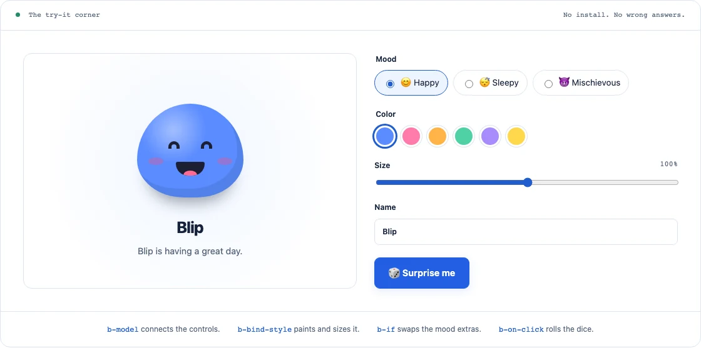
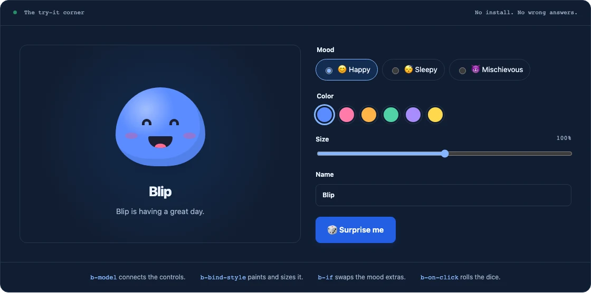

<p align="center">
  <a href="https://briojs.com/#gh-light-mode-only"></a>
  <a href="https://briojs.com/#gh-dark-mode-only"></a>
</p>

<p align="center">
  <strong>Powerfully simple, HTML-first web development.</strong><br>
  Reactive widgets, multi-page sites, and single-page apps on the DOM you already have.
</p>

<p align="center">
  <a href="https://www.npmjs.com/package/@jnreis/briojs"></a>
  <a href="https://github.com/jnreis/briojs/actions/workflows/ci.yml"></a>
  <a href="./LICENSE"></a>
</p>

<p align="center">
  <a href="https://briojs.com">Website</a> ·
  <a href="https://briojs.com/start/getting-started/">Getting started</a> ·
  <a href="https://briojs.com/play/">Playground</a> ·
  <a href="https://briojs.com/examples/">Examples</a> ·
  <a href="./DOCUMENTATION.md">Docs</a> ·
  <a href="https://github.com/jnreis/briojs/discussions">Discussions</a>
</p>

<p align="center">
  <a href="https://briojs.com/try/#gh-light-mode-only"></a>
  <a href="https://briojs.com/try/#gh-dark-mode-only"></a>
</p>

## What is Brio?

Brio adds reactivity to HTML through `b-*` directives. It enhances the real DOM
in place, so you can mount it around one form or menu inside a larger page, or
build a whole app with it. No virtual DOM, JSX, required compiler, or runtime
dependencies.

```html
<div id="counter">
  <button b-on-click="$data.count++">
    Count: <span b-text="$data.count"></span>
  </button>
</div>
```

```js
import { createApp } from '@jnreis/briojs';

createApp({ state: () => ({ count: 0 }) }).mount('#counter');
```

Brio owns only the region you mount. State and props are explicit in
expressions (`$data.count`, `$props.label`, `$for.item`), so you can always tell
where a value comes from.

## Quick start

```sh
npm create brio@latest
```

The scaffolder offers five [starter templates](./templates/) (widget,
multi-page, SPA, Astro islands, and plugin) in JavaScript or TypeScript.

<details>
<summary><strong>Add to an existing project with npm</strong></summary>

```sh
npm install @jnreis/briojs
```

Then use the HTML and JavaScript above. The package is ESM-only, with
TypeScript declarations and tree-shakable exports.

</details>

<details>
<summary><strong>No build step: use a script tag</strong></summary>

Save this as an HTML file and serve it from any static server:

```html
<!doctype html>
<html lang="en">
<head>
  <meta charset="utf-8">
  <meta name="viewport" content="width=device-width, initial-scale=1">
  <title>My first Brio widget</title>
  <style>[b-cloak] { display: none; }</style>
</head>
<body>
  <div id="counter" b-cloak>
    <button b-on-click="$data.count++">
      Count: <span b-text="$data.count"></span>
    </button>
  </div>
  <script src="https://cdn.jsdelivr.net/npm/@jnreis/briojs@5.1.1/dist/brio.min.js"></script>
  <script>
    const app = brio.createApp({ state: () => ({ count: 0 }) });
    app.mount('#counter');
  </script>
</body>
</html>
```

Use `brio.dev.min.js` during development for the live inspector. Pages with a
strict Content Security Policy load `brio.csp.min.js` instead; see the
[CSP build](./DOCUMENTATION.md#strict-csp-build). Load optional add-on scripts
after core and before your own code, and keep their versions aligned.

</details>

## Features

- **HTML directives:** bindings, events with key modifiers, two-way forms, keyed
  lists, conditionals, transitions, refs, templates, and teleports.
- **Fine-grained reactivity:** plain-object state, signals, computed values,
  effects, batching, and cancellable async resources. Also usable without a DOM.
- **Components:** HTML templates with setup functions, reactive props, events,
  slots, scoped slots, and shared stores.
- **Explicit cleanup:** apps and components dispose their effects, listeners,
  and resources when removed. Mount several independent apps on one page.
- **Opt-in add-ons:** router, persistence, HTTP, input masks and validation, DOM
  observers, step flows, devtools, and Astro islands. Load only what a page uses.
- **Plugin API:** add your own directives and expression helpers.
- **Helpful errors:** template errors name the expression, directive, element,
  and component.

**New in 5.1:** a [strict CSP build](./DOCUMENTATION.md#strict-csp-build)
that runs without `eval`, and a `textInterpolation` option for pages that render
user text. See the
[release notes](https://github.com/jnreis/briojs/releases/tag/v5.1.0).

**New in 5.0:** the plugin API, form validation, and a testing helper. Masks
and observers moved to opt-in add-ons. See the
[release notes](https://github.com/jnreis/briojs/releases/tag/v5.0.0) and the
[migration guide](./DOCUMENTATION.md#migrating-from-brio-4).

## Is Brio a good fit?

**Good fit:** server-rendered sites (Rails, Laravel, Django, WordPress, Express)
that need interactive regions, widgets inside larger apps, and small-to-medium
SPAs written as plain HTML and JavaScript.

**Not a fit:** framework-provided server rendering or older browsers.
Runtime expressions are trusted code compiled with `new Function`, not a
sandbox. For a strict CSP without `unsafe-eval`, Brio 5.1+ ships a separate
[CSP build](./DOCUMENTATION.md#strict-csp-build) that interprets expressions
and activates only templates defined in JavaScript. Use `b-text` for user
content; `b-html` does not sanitize. See
[expression security](./DOCUMENTATION.md#trusted-html-and-expression-security).

## Learn more

| Resource | What you’ll find |
| --- | --- |
| [Documentation](./DOCUMENTATION.md) | Directives, components, reactivity, routing, add-ons, and the plugin API. |
| [Playground](https://briojs.com/play/) | Edit HTML, CSS, and JavaScript in the browser and share a link. |
| [Brio Parts](https://briojs.com/parts/) | Copy-paste tabs, disclosure, dialog, and menu components. |
| [Examples](https://briojs.com/examples/) | Live demos, from a counter and TodoMVC to a Kanban board and collaborative editor. ([source](./tests/apps/)) |
| [Integrations](https://briojs.com/integrations/overview/) | Express, Rails, Laravel, Django, and WordPress guides. |
| [Editor autocomplete](https://briojs.com/reference/install/#editor-autocomplete) | `b-*` completions and hover docs in VS Code. |
| [AI developer kit](./ai/README.md) | A guide, skill, and recipes for coding assistants, plus [llms.txt](https://briojs.com/llms.txt). |
| [Changelog](./CHANGELOG.md) | Every release and its migration notes. |

## Community

Brio started as a private project for fun and learning. I've used it in one
small production project of my own and decided it was ready to share. It's
independently maintained, and outside feedback is very welcome.

- **Questions, ideas, or something you built:** [Discussions](https://github.com/jnreis/briojs/discussions) ([say hello](https://github.com/jnreis/briojs/discussions/5))
- **Bugs and feature requests:** [open an issue](https://github.com/jnreis/briojs/issues/new/choose)
- **Security issues:** [report privately](./SECURITY.md)
- **Contributing:** start with the [first-contribution guide](./CONTRIBUTING.md#your-first-contribution)

Please follow the [code of conduct](./CODE_OF_CONDUCT.md).

## License

[MIT](./LICENSE) © Jonathan Reis
